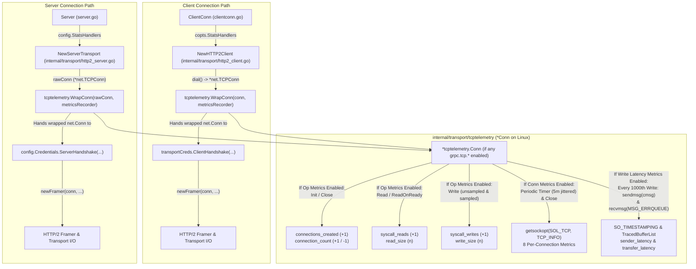
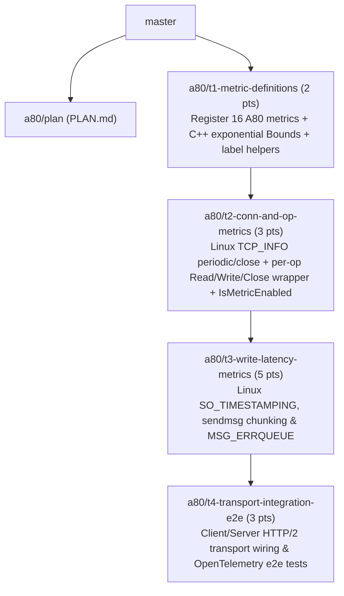

# gRFC A80: Export TCP Telemetry from gRPC — Architectural & Implementation Plan

## 1. Summary, gRFC Reference & Architecture Overview

### 1.1 References
- **Authoritative Specification**: [gRFC A80: Export TCP Telemetry from gRPC (`A80-tcp-telemetry.md`)](https://github.com/grpc/proposal/blob/master/A80-tcp-telemetry.md)
- **Foundation Architecture**: [gRFC A79: Non-Per-Call Metrics Architecture (`A79-non-per-call-metrics-architecture.md`)](https://github.com/grpc/proposal/blob/master/A79-non-per-call-metrics-architecture.md)
- **C++ Reference Implementation**: [`src/core/lib/event_engine/tcp_telemetry.cc`](https://github.com/grpc/grpc/blob/master/src/core/lib/event_engine/tcp_telemetry.cc), [`src/core/telemetry/histogram.h`](https://github.com/grpc/grpc/blob/master/src/core/telemetry/histogram.h), [`src/core/lib/event_engine/posix_engine/internal_errqueue.cc`](https://github.com/grpc/grpc/blob/master/src/core/lib/event_engine/posix_engine/internal_errqueue.cc), [`src/core/lib/event_engine/posix_engine/traced_buffer_list.cc`](https://github.com/grpc/grpc/blob/master/src/core/lib/event_engine/posix_engine/traced_buffer_list.cc), and [`src/core/lib/event_engine/posix_engine/posix_endpoint.cc`](https://github.com/grpc/grpc/blob/master/src/core/lib/event_engine/posix_engine/posix_endpoint.cc) in [`grpc/grpc`](https://github.com/grpc/grpc).

### 1.2 Scope & Agreed Requirements
1. **Platform Support**: TCP telemetry collection is supported on **Linux only** (`//go:build linux`). All non-Linux platforms (`//go:build !linux`) compile cleanly with a zero-overhead no-op wrapper and pass all unit and end-to-end tests.
2. **All 16 Metrics Across Three Categories**:
   - **Per-Connection Metrics (8 metrics)**: Collected periodically via `getsockopt(fd, SOL_TCP, TCP_INFO, ...)` every `5 minutes` (with `10%–110%` initial jitter and `90%–110%` subsequent jitter) and once immediately before closing the TCP socket (`grpc.tcp.recurring_retransmits` is recorded only at socket close time).
   - **Per-Connection Op Metrics (6 metrics)**: Recorded on TCP connection creation, closure, and individual socket read/write syscalls.
   - **Per-Write Metrics (2 metrics)**: Collected on sampled TCP writes (default period `1000` writes with initial random offset in `[0, 1000)`) using Linux kernel socket timestamping (`SO_TIMESTAMPING` + `sendmsg` control messages + `recvmsg(..., MSG_ERRQUEUE)`).
3. **Client & Server Coverage**: Both client (`http2Client`) and server (`http2Server`) TCP connections record telemetry across insecure, TLS ([`credentials/tls.go`](credentials/tls.go)), and ALTS connections.
4. **Opt-In Experimental Registration & Zero Overhead When Disabled**:
   - All 16 metrics are registered in the global [`experimental/stats`](experimental/stats/metricregistry.go) metric registry with `Default: false`.
   - Even when an OpenTelemetry [`estats.MetricsRecorder`](experimental/stats/metrics.go#L33-L52) is registered on a client or server (e.g., for standard default per-call metrics), if **none** of the `grpc.tcp.*` metrics are enabled in `MetricsOptions.Metrics`, `tcptelemetry.WrapConn` returns the `*net.TCPConn` **unwrapped** with zero syscall or timer overhead. Furthermore, `TCP_INFO` periodic timers and `SO_TIMESTAMPING` syscalls are only activated when their respective metric categories are enabled.
5. **Histogram Bucket Boundaries Parity with C++**:
   - All 6 histogram instruments populate `MetricDescriptor.Bounds` using the exact `ExponentialInt64HistogramShape(max, buckets)` algorithm from C++ ([`src/core/telemetry/histogram.h`](https://github.com/grpc/grpc/blob/master/src/core/telemetry/histogram.h) and [`src/core/lib/event_engine/tcp_telemetry.cc`](https://github.com/grpc/grpc/blob/master/src/core/lib/event_engine/tcp_telemetry.cc)), scaled to gRFC A80 units.

### 1.3 High-Level Architecture & Component Layout



#### Why Wrap `*net.TCPConn` Before `ClientHandshake` / `ServerHandshake`?
- **Client**: In [`NewHTTP2Client`](internal/transport/http2_client.go#L238-L328), `dial()` returns the raw `net.Conn` (a `*net.TCPConn` for TCP dials). Immediately after `isyscall.SetTCPUserTimeout`, `transportCreds.ClientHandshake` wraps `conn` (e.g., in `*tls.Conn` wrapped by [`credinternal.WrapSyscallConn`](internal/credentials/syscallconn.go#L46-L59)).
- **Server**: In [`NewServerTransport`](internal/transport/http2_server.go#L149-L180), `rawConn` is passed to `config.Credentials.ServerHandshake(rawConn)`.
- Wrapping the underlying `*net.TCPConn` **before** the TLS/ALTS handshake ensures:
  1. Even when `conn` is subsequently wrapped by `crypto/tls` or ALTS, every underlying socket `Read`, `Write`, and `Close` flows through `*tcptelemetry.Conn`.
  2. By implementing `syscall.Conn` (`SyscallConn() (syscall.RawConn, error)`) on `*tcptelemetry.Conn`, [`credinternal.WrapSyscallConn`](internal/credentials/syscallconn.go#L46-L59), [`isyscall.SetTCPUserTimeout`](internal/syscall/syscall_linux.go#L37-L68), and [`channelz.GetSocketOption`](internal/channelz/syscall_linux.go#L29-L48) continue to work transparently on both insecure and TLS/ALTS connections.
  3. By implementing [`readyreader.Reader`](internal/transport/readyreader/ready_reader.go#L32-L44) (`ReadOnReady(bufSize int, pool mem.BufferPool) (*[]byte, int, error)`) on `*tcptelemetry.Conn`, [`readyreader.NewNonBlocking`](internal/transport/readyreader/ready_reader.go#L68-L71) recognizes `*tcptelemetry.Conn` via its initial `if rr, ok := r.(Reader); ok` check and preserves non-memory-pinning reads on insecure connections while still recording `grpc.tcp.syscall_reads` and `grpc.tcp.read_size` per read syscall.

---

## 2. Detailed Metric Specifications & C++ Exponential Histogram Bounds

All 16 metrics are registered in package `internal/transport/tcptelemetry` via [`estats.RegisterInt64Count`](experimental/stats/metricregistry.go#L232-L237), [`estats.RegisterInt64UpDownCount`](experimental/stats/metricregistry.go#L301-L308), and [`estats.RegisterFloat64Histo`](experimental/stats/metricregistry.go#L273-L279).

Common properties for **all 16 metrics**:
- `Default: false` (experimental, opt-in via `opentelemetry.MetricsOptions{Metrics: ...}`).
- `OptionalLabels`: `[]string{"network.local.address", "network.local.port", "network.peer.address", "network.peer.port"}`.
- Address label formatting from `conn.LocalAddr()` and `conn.RemoteAddr()` (`*net.TCPAddr`):
  - `network.local.address`: `localTCPAddr.IP.String()`
  - `network.local.port`: `strconv.Itoa(localTCPAddr.Port)`
  - `network.peer.address`: `peerTCPAddr.IP.String()`
  - `network.peer.port`: `strconv.Itoa(peerTCPAddr.Port)`

### 2.1 Exponential Histogram Bucket Boundaries (Parity with C++)
To match C++'s `ExponentialInt64HistogramShape(int64_t max, size_t buckets)` in [`src/core/telemetry/histogram.h`](https://github.com/grpc/grpc/blob/master/src/core/telemetry/histogram.h) and [`src/core/lib/event_engine/tcp_telemetry.cc`](https://github.com/grpc/grpc/blob/master/src/core/lib/event_engine/tcp_telemetry.cc), `internal/transport/tcptelemetry/metrics.go` computes `MetricDescriptor.Bounds` via `exponentialBuckets(max int64, buckets int, scale float64) []float64`:

```go
func exponentialBuckets(max int64, buckets int, scale float64) []float64 {
    if max <= int64(buckets) {
        bounds := make([]float64, 0, max)
        for i := int64(0); i < max; i++ {
            bounds = append(bounds, float64(i+1)*scale)
        }
        return bounds
    }
    intBounds := make([]int64, 0, buckets)
    firstBucket := int64(math.Ceil(math.Pow(float64(max), 1.0/float64(buckets+1))))
    if firstBucket <= 1 {
        firstBucket = 1
    }
    intBounds = append(intBounds, firstBucket)
    for len(intBounds) < buckets {
        var nextb int64
        prevb := intBounds[len(intBounds)-1]
        if len(intBounds) == buckets-1 {
            nextb = max
        } else {
            mul := math.Pow(float64(max)/float64(prevb), 1.0/float64(buckets-len(intBounds)))
            nextb = int64(math.Ceil(float64(prevb) * mul))
        }
        if nextb <= prevb+1 {
            nextb = prevb + 1
        }
        intBounds = append(intBounds, nextb)
    }
    bounds := make([]float64, len(intBounds))
    for i, b := range intBounds {
        bounds[i] = float64(b) * scale
    }
    return bounds
}
```

### 2.2 Per-Connection Metrics (8 Metrics)

| Metric Name | Instrument Type | Unit | Required Labels | `Bounds` | Kernel Source (`struct tcp_info`) & Recording Semantics |
| :--- | :--- | :--- | :--- | :--- | :--- |
| `grpc.tcp.min_rtt` | `Float64Histo` | `s` | `nil` | `exponentialBuckets(1<<24, 100, 1e-6)` | `tcpi_min_rtt` ($\mu\text{s}$): recorded as `float64(tcpi_min_rtt) / 1e6` when `tcpi_min_rtt > 0 && tcpi_min_rtt != math.MaxUint32`. |
| `grpc.tcp.delivery_rate` | `Float64Histo` | `By/s` | `nil` | `exponentialBuckets(1<<34, 100, 1.0)` | `tcpi_delivery_rate` (B/s): recorded as `float64(tcpi_delivery_rate)` **only when** `tcpi_delivery_rate_app_limited == false` (`0`). |
| `grpc.tcp.packets_sent` | `Int64Count` | `{packet}` | `nil` | `nil` | `tcpi_data_segs_out`: delta (`curr - prev`) recorded when `curr > prev`. |
| `grpc.tcp.packets_retransmitted` | `Int64Count` | `{packet}` | `nil` | `nil` | `tcpi_total_retrans`: delta (`curr - prev`) recorded when `curr > prev`. |
| `grpc.tcp.packets_spurious_retransmitted` | `Int64Count` | `{packet}` | `nil` | `nil` | `tcpi_dsack_dups`: delta (`curr - prev`) recorded when `curr > prev`. |
| `grpc.tcp.recurring_retransmits` | `Int64Count` | `{packet}` | `nil` | `nil` | `tcpi_retransmits`: recorded **only once at connection close time** when `tcpi_retransmits > 0`. |
| `grpc.tcp.bytes_sent` | `Int64Count` | `By` | `nil` | `nil` | `tcpi_bytes_sent`: delta (`curr - prev`) recorded when `curr > prev`. |
| `grpc.tcp.bytes_retransmitted` | `Int64Count` | `By` | `nil` | `nil` | `tcpi_bytes_retrans`: delta (`curr - prev`) recorded when `curr > prev`. |

### 2.3 Per-Connection Op Metrics (6 Metrics)

| Metric Name | Instrument Type | Unit | Required Labels | `Bounds` | Recording Trigger & Value |
| :--- | :--- | :--- | :--- | :--- | :--- |
| `grpc.tcp.connections_created` | `Int64Count` | `{connection}` | `nil` | `nil` | `+1` when the TCP connection wrapper is created. |
| `grpc.tcp.connection_count` | `Int64UpDownCount` | `{connection}` | `nil` | `nil` | `+1` when the TCP connection wrapper is created; `-1` (guarded by `sync.Once`) when `Close()` is called. |
| `grpc.tcp.syscall_writes` | `Int64Count` | `{syscall}` | `nil` | `nil` | `+1` per socket write syscall (`write` or `sendmsg`) that offers $> 0$ bytes and completes without `EAGAIN`/`EINTR`. |
| `grpc.tcp.write_size` | `Float64Histo` | `By` | `nil` | `exponentialBuckets(8<<20, 20, 1.0)` | `float64(bytesOffered)` per socket write syscall (`write` or `sendmsg`). |
| `grpc.tcp.syscall_reads` | `Int64Count` | `{syscall}` | `nil` | `nil` | `+1` per socket read syscall (`Read` or `ReadOnReady`) that returns $n > 0$ bytes. |
| `grpc.tcp.read_size` | `Float64Histo` | `By` | `nil` | `exponentialBuckets(8<<20, 20, 1.0)` | `float64(n)` per socket read syscall (`Read` or `ReadOnReady`) that returns $n > 0$ bytes. |

### 2.4 Per-Write Metrics (2 Metrics)

| Metric Name | Instrument Type | Unit | Required Labels | `Bounds` | Recording Trigger & Value |
| :--- | :--- | :--- | :--- | :--- | :--- |
| `grpc.tcp.sender_latency` | `Float64Histo` | `s` | `nil` | `exponentialBuckets(1e6, 20, 1e-6)` | `(SCM_TSTAMP_SND - SCM_TSTAMP_SCHED)` in seconds (`float64`) for the first `<= 1024` bytes of a sampled write. |
| `grpc.tcp.transfer_latency` | `Float64Histo` | `s` | `[]string{"grpc.transfer_size"}` | `exponentialBuckets(1e6, 20, 1e-6)` | `(SCM_TSTAMP_ACK - SCM_TSTAMP_SND)` in seconds (`float64`) for the benchmarked prefix of a sampled write, labeled with `"1024"`, `"8196"`, `"65536"`, `"262144"`, or `"2097152"`. |

---

## 3. Detailed Collection Algorithms & Linux Kernel Mechanics

### 3.1 Per-Category Metric Enablement Check (Zero Overhead When Disabled)
To avoid `TCP_INFO` timers, `SO_TIMESTAMPING` `setsockopt` calls, `sendmsg` chunking, or connection wrapping when an OpenTelemetry stats handler is registered without enabling `grpc.tcp.*` metrics:
1. **`IsMetricEnabled(*estats.MetricDescriptor) bool` Method**:
   - In [`stats/opentelemetry/opentelemetry.go`](stats/opentelemetry/opentelemetry.go#L433-L484), [`registryMetrics`](stats/opentelemetry/opentelemetry.go#L433-L447) implements `IsMetricEnabled(desc *estats.MetricDescriptor) bool`, returning `true` iff `desc` was present in `metrics.Metrics()` during `registerMetrics` (i.e., registered in `rm.intCounts`, `rm.floatCounts`, `rm.intHistos`, `rm.floatHistos`, `rm.intGauges`, `rm.intUpDownCounts`, or `rm.intObservableGauges`).
   - In [`internal/stats/metrics_recorder_list.go`](internal/stats/metrics_recorder_list.go#L31-L51), [`MetricsRecorderList`](internal/stats/metrics_recorder_list.go#L31-L35) implements `IsMetricEnabled(desc *estats.MetricDescriptor) bool`:
     - If `len(l.metricsRecorders) == 0`, returns `false`.
     - Otherwise, iterates over `l.metricsRecorders`: if an underlying recorder implements `interface{ IsMetricEnabled(*estats.MetricDescriptor) bool }`, checks `mr.IsMetricEnabled(desc)`; if an underlying recorder does **not** implement `IsMetricEnabled` (such as [`TestMetricsRecorder`](internal/testutils/stats/test_metrics_recorder.go#L37-L50) in unit tests), treats it as enabled (`true`). Returns `true` if at least one underlying recorder has `desc` enabled.
2. **Per-Category Gating in `tcptelemetry.WrapConn`**:
   - `WrapConn` evaluates three boolean flags via `isMetricEnabled(recorder, desc)`:
     - `enableConnMetrics`: `true` if any of the 8 Per-Connection metrics is enabled.
     - `enableOpMetrics`: `true` if any of the 6 Per-Connection Op metrics is enabled.
     - `enableWriteLatencyMetrics`: `true` if any of the 2 Per-Write metrics is enabled.
   - If `!enableConnMetrics && !enableOpMetrics && !enableWriteLatencyMetrics`, `WrapConn` returns `conn` **unwrapped** immediately.
   - Otherwise, `*tcptelemetry.Conn` only activates the subsystems for the enabled categories (`enableConnMetrics` gates the periodic/close `TCP_INFO` collector; `enableOpMetrics` gates connection/read/write op counters; `enableWriteLatencyMetrics` gates `SO_TIMESTAMPING`, `sendmsg` chunking, and `MSG_ERRQUEUE` draining).

### 3.2 Per-Connection Collector (`TCP_INFO` via `getsockopt`)
1. **Periodic Timer & Jitter**:
   - Default collection interval: package variable `ConnectionMetricsRecordInterval = 5 * time.Minute` (overridable in unit/e2e tests).
   - **Initial delay**: Uniformly distributed in `[0.10 * interval, 1.10 * interval)` (`(0.10 + rand.Float64()) * float64(interval)`).
   - **Subsequent delays**: Uniformly distributed in `[0.90 * interval, 1.10 * interval)` (`(0.90 + 0.20*rand.Float64()) * float64(interval)`).
   - **Final collection on `Close()`**: Before `c.TCPConn.Close()` closes the underlying socket FD, stop the periodic timer, perform one final `collectTCPInfo(true /* isClose */)` call, and then invoke `c.TCPConn.Close()`.
2. **Extracting `struct tcp_info` and `tcpi_delivery_rate_app_limited`**:
   - In Linux `<linux/tcp.h>`, byte offset `6` is `tcpi_snd_wscale:4, tcpi_rcv_wscale:4` and byte offset `7` is `tcpi_delivery_rate_app_limited:1, tcpi_fastopen_client_fail:2` (little-endian bitfield: bit 0 of byte 7 is `tcpi_delivery_rate_app_limited`).
   - Because `golang.org/x/sys/unix.TCPInfo` omits bitfield fields in `cgo -godefs` (leaving 2 bytes of unexported compiler padding at offsets 6–7 between `Options uint8` at offset 5 and `Rto uint32` at offset 8), we read `struct tcp_info` via `unix.Syscall6(unix.SYS_GETSOCKOPT, fd, unix.SOL_TCP, unix.TCP_INFO, ...)`:
     - Verify the returned `optlen` covers the fields accessed (matching C++ `length >= offsetof(tcp_info, tcpi_bytes_retrans) + sizeof(tcpi_bytes_retrans)`).
     - Extract `deliveryRateAppLimited := (raw[7] & 0x01) != 0`.
3. **Cumulative Counter Deltas**:
   - Kernel fields `tcpi_data_segs_out`, `tcpi_total_retrans`, `tcpi_dsack_dups`, `tcpi_bytes_sent`, and `tcpi_bytes_retrans` are monotonically increasing cumulative totals over the life of the socket.
   - Because OpenTelemetry `Int64Counter` (`RecordInt64Count`) records increments (`Add`), `*tcptelemetry.Conn` stores the last recorded snapshot (`prevDataSegsOut`, `prevTotalRetrans`, `prevDsackDups`, `prevBytesSent`, `prevBytesRetrans`).
   - On each collection (both periodic and final on close), for each counter: if `curr > prev`, record `int64(curr - prev)` and update `prev = curr`.
   - `grpc.tcp.recurring_retransmits` (`tcpi_retransmits`) is recorded only when `isClose == true` and `info.Retransmits > 0`.

### 3.3 Per-Write Collector (`SO_TIMESTAMPING`, `sendmsg` Chunking & `MSG_ERRQUEUE`)
1. **Socket Initialization**:
   - When wrapping `*net.TCPConn` on Linux with `enableWriteLatencyMetrics == true`, enable kernel TX timestamping via `syscall.RawConn.Control`:
     ```go
     const timestampingFlags = unix.SOF_TIMESTAMPING_SOFTWARE |
         unix.SOF_TIMESTAMPING_OPT_ID |
         unix.SOF_TIMESTAMPING_OPT_TSONLY |
         unix.SOF_TIMESTAMPING_OPT_ID_TCP |
         unix.SOF_TIMESTAMPING_OPT_STATS
     err := unix.SetsockoptInt(int(fd), unix.SOL_SOCKET, unix.SO_TIMESTAMPING, timestampingFlags)
     ```
   - `SOF_TIMESTAMPING_OPT_ID | SOF_TIMESTAMPING_OPT_ID_TCP` instructs the kernel to set `ee_data` in `sock_extended_err` to the 32-bit relative TCP sequence number (byte offset `cumulativeBytesWritten - 1`, wrapping modulo $2^{32}$, initialized to `0` when `SO_TIMESTAMPING` is set before any bytes are written).
   - If `setsockopt(SO_TIMESTAMPING)` fails (e.g., on an older or restricted kernel), log at V-level 2 and gracefully disable per-write latency sampling for that connection while keeping other enabled categories active.
2. **Write Sampling & Size Buckets**:
   - Default sampling period: package variable `LatencyRecordPeriod = 1000` writes (overridable in unit/e2e tests).
   - Each connection initializes `writesCounter` to a random integer in `[0, LatencyRecordPeriod)`.
   - On each `Write(b []byte)` call with `len(b) > 0`, increment `writesCounter`. When `writesCounter >= LatencyRecordPeriod` (and there is no in-flight uncollected timestamp measurement exceeding the max pending limit), reset `writesCounter = 0` and sample this write.
   - Bucket selection for a sampled write of size $N = \text{len}(b)$ per gRFC A80:

     | Write Size Range $N$ | Sampled Prefix (`benchmarkSize`) | `grpc.transfer_size` Label Value | `sendmsg` Chunking Strategy |
     | :--- | :--- | :--- | :--- |
     | $[1, 1024)$ | $N$ | `"1024"` | **1 chunk**: `b[:N]` with `TX_SCHED \| TX_SOFTWARE \| TX_ACK` |
     | $[1024, 8192)$ | $1024$ | `"1024"` | **1 sampled chunk**: `b[:1024]` with `TX_SCHED \| TX_SOFTWARE \| TX_ACK`, followed by unsampled `b[1024:]` |
     | $[8192, 65536)$ | $8192$ | `"8196"` | **2 sampled chunks**: `b[:1024]` (`TX_SCHED \| TX_SOFTWARE`), `b[1024:8192]` (`TX_ACK`), followed by unsampled `b[8192:]` |
     | $[65536, 262144)$ | $65536$ | `"65536"` | **2 sampled chunks**: `b[:1024]` (`TX_SCHED \| TX_SOFTWARE`), `b[1024:65536]` (`TX_ACK`), followed by unsampled `b[65536:]` |
     | $[262144, 2097152)$ | $262144$ | `"262144"` | **2 sampled chunks**: `b[:1024]` (`TX_SCHED \| TX_SOFTWARE`), `b[1024:262144]` (`TX_ACK`), followed by unsampled `b[262144:]` |
     | $[2097152, +\infty)$ | $2097152$ | `"2097152"` | **2 sampled chunks**: `b[:1024]` (`TX_SCHED \| TX_SOFTWARE`), `b[1024:2097152]` (`TX_ACK`), followed by unsampled `b[2097152:]` |

   - *Note*: The label `"8196"` for the $[8\text{ KiB}, 64\text{ KiB})$ bucket is explicitly specified in [gRFC A80](https://github.com/grpc/proposal/blob/master/A80-tcp-telemetry.md#per-write-metrics) and matches C++ `TcpTelemetryDomain` in [`src/core/lib/event_engine/tcp_telemetry.cc`](https://github.com/grpc/grpc/blob/master/src/core/lib/event_engine/tcp_telemetry.cc).
3. **Sequence Tracking & Partial Write Handling**:
   - The connection tracks `seqNo uint32` (total bytes successfully written to the socket modulo $2^{32}$).
   - Because Linux attaches a `cmsg` (`SOL_SOCKET`, `SO_TIMESTAMPING`) timestamp request to the **last byte actually accepted** by `sendmsg` (`targetSeq = prevSeqNo + uint32(bytesWritten) - 1`), our `sendmsgWithTimestamp` helper uses `syscall.RawConn.Write` with `unix.SendmsgN`:
     - For a 1-chunk sampled write (`benchmarkSize <= 1024`): sends `b[:benchmarkSize]` with `SOF_TIMESTAMPING_TX_SCHED | SOF_TIMESTAMPING_TX_SOFTWARE | SOF_TIMESTAMPING_TX_ACK`. If `n > 0` bytes are written, both the `SCHED`/`SND` sequence key and `ACK` sequence key are `seqNo + uint32(n) - 1`. (If a partial write `n < len(b)` occurred, the remaining `b[n:]` is written via standard `Write` loop to preserve `io.Writer` contract).
     - For a 2-chunk sampled write (`benchmarkSize > 1024`):
       1. Sends `b[:1024]` with `SOF_TIMESTAMPING_TX_SCHED | SOF_TIMESTAMPING_TX_SOFTWARE`. If `n1 > 0`, records `schedSndSeqKey = seqNo + uint32(n1) - 1` (and if `n1 < 1024`, writes remaining `b[n1:1024]` without flags).
       2. Sends `b[1024:benchmarkSize]` with `SOF_TIMESTAMPING_TX_ACK`. If `n2 == benchmarkSize - 1024`, records `ackSeqKey = seqNo + uint32(n2) - 1`. If `n2 < benchmarkSize - 1024` (partial write on chunk 2), we still know `ackSeqKey = seqNo + uint32(n2) - 1`, though if `n1 + n2` falls into a smaller bucket or fails, we discard the `transfer_latency` measurement while still keeping `sender_latency`.
       3. Sends any remaining unsampled tail `b[benchmarkSize:]` via normal socket write.
4. **Draining `MSG_ERRQUEUE` and Parsing Timestamps (`tracedBufferList`)**:
   - Each sampled write adds a `tracedBuffer` entry to the connection's `tracedBufferList`:
     - `schedSndSeqNo uint32` (expected `ee_data` for `SCM_TSTAMP_SCHED` and `SCM_TSTAMP_SND`)
     - `ackSeqNo uint32` (expected `ee_data` for `SCM_TSTAMP_ACK`)
     - `transferSizeLabel string` (`"1024"`, `"8196"`, `"65536"`, `"262144"`, or `"2097152"`)
     - `schedTime time.Time`, `sndTime time.Time`, `ackTime time.Time`
     - `senderRecorded bool`, `createdAt time.Time`
   - `drainErrQueue()` calls `unix.Recvmsg(fd, nil, oob, unix.MSG_ERRQUEUE|unix.MSG_DONTWAIT)` in a loop until `unix.EAGAIN` / `unix.EWOULDBLOCK`:
     - Parses socket control messages via `unix.ParseSocketControlMessage(oob[:oobn])`.
     - Extracts:
       - `(SOL_IP / IP_RECVERR)` or `(SOL_IPV6 / IPV6_RECVERR)` -> `unix.SockExtendedErr`: checks `ee_errno == unix.ENOMSG` and `ee_origin == unix.SO_EE_ORIGIN_TIMESTAMPING`; `ee_info` gives timestamp type (`unix.SCM_TSTAMP_SCHED`, `unix.SCM_TSTAMP_SND`, `unix.SCM_TSTAMP_ACK`) and `ee_data` gives the 32-bit TCP sequence number.
       - `(SOL_SOCKET / SCM_TIMESTAMPING)` -> `unix.ScmTimestamping` (3 `unix.Timespec` structs; `ts[0]` is the software timestamp).
     - Updates the matching `tracedBuffer`:
       - Once both `schedTime` and `sndTime` are populated for `schedSndSeqNo` (and `!senderRecorded`): if `sndTime >= schedTime`, records `grpc.tcp.sender_latency` = `sndTime.Sub(schedTime).Seconds()`, and marks `senderRecorded = true`.
       - Once both `sndTime` and `ackTime` are populated for `ackSeqNo`: if `ackTime >= sndTime`, records `grpc.tcp.transfer_latency` = `ackTime.Sub(sndTime).Seconds()` with required label `grpc.transfer_size = transferSizeLabel`, and removes the `tracedBuffer` from the list.
     - **Stale Entry Eviction**: Any `tracedBuffer` older than `maxPendingDuration` (e.g., `1 * time.Minute`) is evicted during `drainErrQueue()` so unacknowledged writes never accumulate unbounded memory.
   - **When `drainErrQueue()` is Invoked**:
     1. Immediately after a sampled `Write` (captures `SCM_TSTAMP_SCHED` and often `SCM_TSTAMP_SND`, which the kernel generates synchronously or near-synchronously in `tcp_transmit_skb`).
     2. On subsequent `Write` and `Read` / `ReadOnReady` calls whenever `tracedBufferList` is non-empty (since incoming TCP ACKs and HTTP/2 frames wake the transport reader/writer).
     3. On periodic timer ticks when `tracedBufferList` is non-empty, and once during `Close()` before closing the socket FD.

---

## 4. Plumbing `MetricsRecorder` to Client & Server Transports

### 4.1 Client Side (`clientconn.go` & `internal/transport/http2_client.go`)
- [`ClientConn`](clientconn.go#L618-L625) already constructs `cc.metricsRecorderList = istats.NewMetricsRecorderList(dopts.copts.StatsHandlers)` and passes `dopts.copts` ([`transport.ConnectOptions`](internal/transport/transport.go#L624-L662)) to [`transport.NewHTTP2Client`](internal/transport/http2_client.go#L223).
- In `NewHTTP2Client`:
  - `opts.StatsHandlers` is already present on [`ConnectOptions`](internal/transport/transport.go#L643).
  - If `len(opts.StatsHandlers) > 0`, construct `metricsRecorder := istats.NewMetricsRecorderList(opts.StatsHandlers)` and call `conn = tcptelemetry.WrapConn(conn, metricsRecorder)` right after `dial()` and `isyscall.SetTCPUserTimeout(conn, kp.Timeout)` (around line 292 of [`internal/transport/http2_client.go`](internal/transport/http2_client.go#L286-L292)) and **before** `transportCreds.ClientHandshake`.
  - Ensure `NewHTTP2Client`'s error-cleanup `defer` (lines 247–251) and `connectCtx` cancellation monitor goroutine (lines 265–275) close the wrapped `conn` if `NewHTTP2Client` aborts after wrapping so `grpc.tcp.connection_count` (`-1`) and timer cleanup always run.

### 4.2 Server Side (`server.go` & `internal/transport/http2_server.go`)
- On [`Server`](server.go#L155-L215), `s.opts.statsHandlers` holds `[]stats.Handler`. Currently, `s.statsHandler` is created via [`istats.NewCombinedHandler(s.opts.statsHandlers...)`](internal/stats/stats.go#L35-L44).
  - When both OpenTelemetry metrics and tracing are enabled on the server, `len(s.opts.statsHandlers) == 2`, so `NewCombinedHandler` returns `*combinedHandler`, which does **not** implement `estats.MetricsRecorder`.
- Therefore, we add `StatsHandlers []stats.Handler` to [`transport.ServerConfig`](internal/transport/transport.go#L604-L622) and populate it in [`(*Server).newHTTP2Transport`](server.go#L1031-L1052) from `s.opts.statsHandlers`.
- In [`NewServerTransport`](internal/transport/http2_server.go#L139-L170):
  - At the start of `NewServerTransport` (before `config.Credentials.ServerHandshake(rawConn)`), if `len(config.StatsHandlers) > 0`, construct `metricsRecorder := istats.NewMetricsRecorderList(config.StatsHandlers)` and wrap `rawConn = tcptelemetry.WrapConn(rawConn, metricsRecorder)`.
  - Add a `defer func() { if err != nil { rawConn.Close() } }()` in `NewServerTransport` after wrapping so that if handshake or initial preface write fails, the wrapper's `Close()` is guaranteed to execute (and since `*tcptelemetry.Conn.Close()` is guarded by `sync.Once`, `newHTTP2Transport`'s subsequent `c.Close()` is safe).

---

## 5. PR Task Split Table & Git Branch Topology

To make human code review straightforward, we split the implementation into **4 small, self-contained PR tasks** (`t1`–`t4`), all under the `a80/` branch namespace:

| Task ID | Branch Name | Base Branch | Story Points (Fibonacci) | Summary |
| :--- | :--- | :--- | :---: | :--- |
| **`t1`** | `a80/t1-metric-definitions` | `master` | **2** | `tcptelemetry: register gRFC A80 TCP telemetry metric instruments` |
| **`t2`** | `a80/t2-conn-and-op-metrics` | `a80/t1-metric-definitions` | **3** | `tcptelemetry: implement TCP wrapper for per-connection and per-op metrics` |
| **`t3`** | `a80/t3-write-latency-metrics` | `a80/t2-conn-and-op-metrics` | **5** | `tcptelemetry: implement SO_TIMESTAMPING and MSG_ERRQUEUE per-write latency metrics` |
| **`t4`** | `a80/t4-transport-integration-e2e` | `a80/t3-write-latency-metrics` | **3** | `transport, stats/opentelemetry: wire TCP telemetry into HTTP/2 transports and add e2e tests` |

### Git Branch Dependency DAG



Because `t1 -> t2 -> t3 -> t4` forms a clean linear chain where each layer builds directly on the previous one inside `internal/transport/tcptelemetry` and then wires into `internal/transport` and `stats/opentelemetry`, every branch is a single-dependency branch off its predecessor and can be rebased onto `master` via `git rebase --onto master <parent-branch> <task-branch>` as PRs merge.

---

## 6. Detailed Per-PR Task Cards

---

### Task `t1`: Register gRFC A80 TCP Telemetry Metric Instruments

- **Task ID**: `t1`
- **Proposed Branch Name**: `a80/t1-metric-definitions`
- **Depends On & Base Branch**: `master`
- **Story Point Score (Fibonacci)**: **2**
- **Summary**: `tcptelemetry: register gRFC A80 TCP telemetry metric instruments`
- **User-Facing Status**: `RELEASE NOTES: N/A` (Internal package defining experimental metric handles; not yet wired to transports).

#### Description (Shared Contract for Implementer, Tester, Reviewers & Human)
Create the new internal package `google.golang.org/grpc/internal/transport/tcptelemetry` and register all 16 experimental TCP telemetry metrics specified in [gRFC A80](https://github.com/grpc/proposal/blob/master/A80-tcp-telemetry.md) using the global metric registry in [`experimental/stats/metricregistry.go`](experimental/stats/metricregistry.go), including C++ parity exponential bucket boundaries (`Bounds`) for the 6 histogram metrics.

**Exact Behavioral Requirements & Invariants**:
1. **Exponential Bucket Boundaries Helper (`exponentialBuckets`)**:
   - Implement `exponentialBuckets(max int64, buckets int, scale float64) []float64` matching C++ `ExponentialInt64HistogramShape(int64_t max, size_t buckets)` in [`src/core/telemetry/histogram.h`](https://github.com/grpc/grpc/blob/master/src/core/telemetry/histogram.h) (see Section 2.1).
2. **Metric Descriptors**:
   - Define and register all 16 metrics with `Default: false` and `OptionalLabels: []string{"network.local.address", "network.local.port", "network.peer.address", "network.peer.port"}`:
     1. `grpc.tcp.min_rtt`: `RegisterFloat64Histo`, Unit `"s"`, Labels `nil`, `Bounds: exponentialBuckets(1<<24, 100, 1e-6)`, Description `"EXPERIMENTAL. Minimum RTT observed on the TCP connection."`
     2. `grpc.tcp.delivery_rate`: `RegisterFloat64Histo`, Unit `"By/s"`, Labels `nil`, `Bounds: exponentialBuckets(1<<34, 100, 1.0)`, Description `"EXPERIMENTAL. Delivery rate of the TCP connection when not application-limited."`
     3. `grpc.tcp.packets_sent`: `RegisterInt64Count`, Unit `"{packet}"`, Labels `nil`, Description `"EXPERIMENTAL. Number of TCP data segments sent on the connection."`
     4. `grpc.tcp.packets_retransmitted`: `RegisterInt64Count`, Unit `"{packet}"`, Labels `nil`, Description `"EXPERIMENTAL. Total number of retransmitted TCP packets on the connection."`
     5. `grpc.tcp.packets_spurious_retransmitted`: `RegisterInt64Count`, Unit `"{packet}"`, Labels `nil`, Description `"EXPERIMENTAL. Number of spurious retransmitted TCP packets (DSACK duplicates) reported on the connection."`
     6. `grpc.tcp.recurring_retransmits`: `RegisterInt64Count`, Unit `"{packet}"`, Labels `nil`, Description `"EXPERIMENTAL. Number of recurring unrecovered TCP timeouts/retransmits at connection close."`
     7. `grpc.tcp.bytes_sent`: `RegisterInt64Count`, Unit `"By"`, Labels `nil`, Description `"EXPERIMENTAL. Number of TCP data bytes sent (acknowledged or unacknowledged), including retransmitted bytes."`
     8. `grpc.tcp.bytes_retransmitted`: `RegisterInt64Count`, Unit `"By"`, Labels `nil`, Description `"EXPERIMENTAL. Number of TCP bytes retransmitted on the connection."`
     9. `grpc.tcp.connections_created`: `RegisterInt64Count`, Unit `"{connection}"`, Labels `nil`, Description `"EXPERIMENTAL. Total number of TCP connections created."`
     10. `grpc.tcp.connection_count`: `RegisterInt64UpDownCount`, Unit `"{connection}"`, Labels `nil`, Description `"EXPERIMENTAL. Current number of active TCP connections."`
     11. `grpc.tcp.syscall_writes`: `RegisterInt64Count`, Unit `"{syscall}"`, Labels `nil`, Description `"EXPERIMENTAL. Number of write syscalls performed on TCP connections."`
     12. `grpc.tcp.write_size`: `RegisterFloat64Histo`, Unit `"By"`, Labels `nil`, `Bounds: exponentialBuckets(8<<20, 20, 1.0)`, Description `"EXPERIMENTAL. Number of bytes offered in each write syscall on TCP connections."`
     13. `grpc.tcp.syscall_reads`: `RegisterInt64Count`, Unit `"{syscall}"`, Labels `nil`, Description `"EXPERIMENTAL. Number of read syscalls performed on TCP connections."`
     14. `grpc.tcp.read_size`: `RegisterFloat64Histo`, Unit `"By"`, Labels `nil`, `Bounds: exponentialBuckets(8<<20, 20, 1.0)`, Description `"EXPERIMENTAL. Number of bytes read in each read syscall on TCP connections."`
     15. `grpc.tcp.sender_latency`: `RegisterFloat64Histo`, Unit `"s"`, Labels `nil`, `Bounds: exponentialBuckets(1e6, 20, 1e-6)`, Description `"EXPERIMENTAL. TCP sender latency from packet scheduling to transmission."`
     16. `grpc.tcp.transfer_latency`: `RegisterFloat64Histo`, Unit `"s"`, Labels `[]string{"grpc.transfer_size"}`, `Bounds: exponentialBuckets(1e6, 20, 1e-6)`, Description `"EXPERIMENTAL. TCP transfer latency from transmission to acknowledgment."`
3. **Label Extraction & Transfer Size Bucket Helpers**:
   - Provide `extractAddressLabels(localAddr, remoteAddr net.Addr) [4]string` that extracts `[localIP, localPort, peerIP, peerPort]` from `*net.TCPAddr` (with fallback to `net.SplitHostPort` if needed).
   - Provide `transferSizeBucket(writeLen int) (benchmarkSize int, label string)` implementing the exact 6-tier A80 table:
     - `writeLen < 1024`: `return writeLen, "1024"`
     - `writeLen < 8192`: `return 1024, "1024"`
     - `writeLen < 65536`: `return 8192, "8196"`
     - `writeLen < 262144`: `return 65536, "65536"`
     - `writeLen < 2097152`: `return 262144, "262144"`
     - `writeLen >= 2097152`: `return 2097152, "2097152"`

#### File-by-File Changes
- **New**: `internal/transport/tcptelemetry/metrics.go` — Registers the 16 metric descriptors (with C++ parity `Bounds` via `exponentialBuckets`) and defines address label extraction and transfer size bucket helpers.
- **New**: `internal/transport/tcptelemetry/metrics_test.go` — Unit tests verifying descriptor registration in `estats.DescriptorForMetric`, `Default: false` status (not in `estats.DefaultMetrics`), units, required/optional labels, `exponentialBuckets` properties (strictly increasing, exact length and max boundary matching C++), IPv4/IPv6 address label formatting, and boundary cases for `transferSizeBucket`.

#### Test Plan
- `go test -v ./internal/transport/tcptelemetry/...`
- `go test -race -cpu 1,4 -timeout 7m ./internal/transport/tcptelemetry/...`
- `./scripts/vet.sh`

---

### Task `t2`: Implement TCP Wrapper for Per-Connection and Per-Connection Op Metrics

- **Task ID**: `t2`
- **Proposed Branch Name**: `a80/t2-conn-and-op-metrics`
- **Depends On & Base Branch**: `a80/t1-metric-definitions`
- **Story Point Score (Fibonacci)**: **3**
- **Summary**: `tcptelemetry: implement TCP wrapper for per-connection and per-op metrics`
- **User-Facing Status**: `RELEASE NOTES: N/A` (Internal package implementation and unit tests).

#### Description (Shared Contract for Implementer, Tester, Reviewers & Human)
Implement `IsMetricEnabled(*estats.MetricDescriptor) bool` on [`istats.MetricsRecorderList`](internal/stats/metrics_recorder_list.go#L31-L35) and [`stats/opentelemetry.registryMetrics`](stats/opentelemetry/opentelemetry.go#L433-L447), and implement the `net.Conn` wrapper (`WrapConn(conn net.Conn, recorder estats.MetricsRecorder) net.Conn`) in `internal/transport/tcptelemetry` for Linux (`//go:build linux`) and non-Linux (`//go:build !linux`) covering the **6 Per-Connection Op Metrics** and the **8 Per-Connection Metrics** (`TCP_INFO`).

**Exact Behavioral Requirements & Invariants**:
1. **Per-Metric & Per-Category Enablement (`IsMetricEnabled`)**:
   - Add `IsMetricEnabled(desc *estats.MetricDescriptor) bool` to `MetricsRecorderList` in [`internal/stats/metrics_recorder_list.go`](internal/stats/metrics_recorder_list.go) and `registryMetrics` in [`stats/opentelemetry/opentelemetry.go`](stats/opentelemetry/opentelemetry.go) (see Section 3.1).
   - In `WrapConn`:
     - On non-Linux (`conn_other.go`), return `conn` unchanged.
     - On Linux (`conn_linux.go`), if `recorder == nil`, or `conn` is not a `*net.TCPConn`, or **none** of the 16 `grpc.tcp.*` metrics are enabled on `recorder`, or `conn.SyscallConn()` fails, return `conn` unchanged.
     - Track `enableConnMetrics`, `enableOpMetrics`, and `enableWriteLatencyMetrics` on `*Conn` so disabled categories incur zero timer or syscall overhead.
2. **Preserved Interfaces on `*Conn` (Linux)**:
   - Embeds `*net.TCPConn`.
   - Implements `syscall.Conn` (`SyscallConn() (syscall.RawConn, error)`) by delegating to `c.TCPConn.SyscallConn()`, so [`credinternal.WrapSyscallConn`](internal/credentials/syscallconn.go#L46-L59), [`isyscall.SetTCPUserTimeout`](internal/syscall/syscall_linux.go#L37-L68), and [`channelz.GetSocketOption`](internal/channelz/syscall_linux.go#L29-L48) continue to work.
   - Implements [`readyreader.Reader`](internal/transport/readyreader/ready_reader.go#L32-L44) (`ReadOnReady(bufSize int, pool mem.BufferPool) (*[]byte, int, error)`): delegates to an internal `readyreader.Reader` initialized over `c.TCPConn` during `WrapConn`, and when `n > 0` and `c.enableOpMetrics` is true, records `grpc.tcp.syscall_reads` (`+1`) and `grpc.tcp.read_size` (`float64(n)`).
3. **Per-Connection Op Metrics (when `enableOpMetrics == true`)**:
   - In `WrapConn`: records `grpc.tcp.connections_created` (`+1`) and `grpc.tcp.connection_count` (`+1`).
   - In `Read(b []byte)`: calls `c.TCPConn.Read(b)`. If `n > 0`, records `grpc.tcp.syscall_reads` (`+1`) and `grpc.tcp.read_size` (`float64(n)`).
   - In `Write(b []byte)`: calls `c.TCPConn.Write(b)`. If `len(b) > 0` and `n > 0`, records `grpc.tcp.syscall_writes` (`+1`) and `grpc.tcp.write_size` (`float64(len(b))`). (Task `t3` will extend `Write` with sampled `sendmsg` calls when `enableWriteLatencyMetrics == true`).
   - In `Close()`: guarded by `closeOnce sync.Once`, stops the periodic `TCP_INFO` collector (if started), runs one final `TCP_INFO` collection (`isClose = true`, if `enableConnMetrics == true`) **before** closing the socket FD, records `grpc.tcp.connection_count` (`-1`, if `enableOpMetrics == true`), and calls `c.TCPConn.Close()`.
4. **Per-Connection Metrics (`TCP_INFO` Periodic & Close Collection when `enableConnMetrics == true`)**:
   - Default interval package variable `ConnectionMetricsRecordInterval = 5 * time.Minute`.
   - Initial timer delay jittered in `[0.10 * interval, 1.10 * interval)`; subsequent timer delays jittered in `[0.90 * interval, 1.10 * interval)`.
   - Queries `getsockopt(fd, SOL_TCP, TCP_INFO, ...)` via `rawConn.Control`.
   - Extracts `tcpi_delivery_rate_app_limited` from bit 0 of byte offset 7 of `struct tcp_info`.
   - Records:
     - `grpc.tcp.min_rtt`: `float64(info.Min_rtt) / 1e6` if `info.Min_rtt > 0 && info.Min_rtt != math.MaxUint32`.
     - `grpc.tcp.delivery_rate`: `float64(info.Delivery_rate)` only if `!deliveryRateAppLimited`.
     - Deltas (`curr - prev`) when `curr > prev` for `grpc.tcp.packets_sent` (`Data_segs_out`), `grpc.tcp.packets_retransmitted` (`Total_retrans`), `grpc.tcp.packets_spurious_retransmitted` (`Dsack_dups`), `grpc.tcp.bytes_sent` (`Bytes_sent`), and `grpc.tcp.bytes_retransmitted` (`Bytes_retrans`).
     - `grpc.tcp.recurring_retransmits` (`Retransmits`): recorded only when `isClose == true` and `info.Retransmits > 0`.
   - Thread safety: `collectTCPInfo` is protected by a mutex `tcpInfoMu sync.Mutex` so a concurrent timer callback and `Close()` cannot race or double-count counter deltas.

#### File-by-File Changes
- **Modify**: [`internal/stats/metrics_recorder_list.go`](internal/stats/metrics_recorder_list.go) — Add `IsMetricEnabled(desc *estats.MetricDescriptor) bool` on `MetricsRecorderList`.
- **Modify**: [`stats/opentelemetry/opentelemetry.go`](stats/opentelemetry/opentelemetry.go#L433-L484) — Add `IsMetricEnabled(desc *estats.MetricDescriptor) bool` on `registryMetrics`.
- **New**: `internal/transport/tcptelemetry/conn_linux.go` — Linux implementation of `*Conn`, `WrapConn`, `Read`, `ReadOnReady`, `Write`, `Close`, `SyscallConn`, and periodic/close `TCP_INFO` collection.
- **New**: `internal/transport/tcptelemetry/conn_other.go` — Non-Linux (`//go:build !linux`) no-op `WrapConn`.
- **New**: `internal/transport/tcptelemetry/tcpinfo_linux.go` — `getsockopt(SOL_TCP, TCP_INFO)` reader, `tcpi_delivery_rate_app_limited` bitfield extraction, and delta calculation logic.
- **New**: `internal/transport/tcptelemetry/conn_linux_test.go` — Linux unit tests using real loopback `*net.TCPConn` pairs and [`internal/testutils/stats.TestMetricsRecorder`](internal/testutils/stats/test_metrics_recorder.go) to verify:
  - `WrapConn` returns `conn` unwrapped when no `grpc.tcp.*` metrics are enabled on the recorder, and selectively activates categories when enabled.
  - `connections_created` and `connection_count` (`+1` on open, `-1` on close, idempotent on multiple `Close()` calls).
  - `syscall_writes`, `write_size`, `syscall_reads`, and `read_size` via both `Read` and `ReadOnReady`.
  - Periodic and on-close `TCP_INFO` collection (`min_rtt`, `delivery_rate` gating on `app_limited`, delta calculations for `packets_sent`, `bytes_sent`, etc., and `recurring_retransmits` on close).
  - Clean goroutine/timer termination (`grpctest.Tester` leakcheck).

#### Test Plan
- `go test -v ./internal/stats/... ./internal/transport/tcptelemetry/... ./stats/opentelemetry/...`
- `go test -race -cpu 1,4 -timeout 7m ./internal/transport/tcptelemetry/...`
- `GOOS=darwin go build ./internal/transport/tcptelemetry/...` and `GOOS=windows go build ./internal/transport/tcptelemetry/...`
- `./scripts/vet.sh`

---

### Task `t3`: Implement `SO_TIMESTAMPING` and `MSG_ERRQUEUE` Per-Write Latency Metrics

- **Task ID**: `t3`
- **Proposed Branch Name**: `a80/t3-write-latency-metrics`
- **Depends On & Base Branch**: `a80/t2-conn-and-op-metrics`
- **Story Point Score (Fibonacci)**: **5**
- **Summary**: `tcptelemetry: implement SO_TIMESTAMPING and MSG_ERRQUEUE per-write latency metrics`
- **User-Facing Status**: `RELEASE NOTES: N/A` (Internal package implementation and unit tests).

#### Description (Shared Contract for Implementer, Tester, Reviewers & Human)
Extend `*tcptelemetry.Conn` on Linux to collect the 2 **Per-Write Metrics** (`grpc.tcp.sender_latency` and `grpc.tcp.transfer_latency`) when `enableWriteLatencyMetrics == true` using Linux socket timestamping (`SO_TIMESTAMPING`), chunked `sendmsg` control messages, and `recvmsg(..., MSG_ERRQUEUE)`.

**Exact Behavioral Requirements & Invariants**:
1. **Socket Option Setup**:
   - In `WrapConn`, when `enableWriteLatencyMetrics == true`, configure `SOL_SOCKET` / `SO_TIMESTAMPING` with flags `SOF_TIMESTAMPING_SOFTWARE | SOF_TIMESTAMPING_OPT_ID | SOF_TIMESTAMPING_OPT_TSONLY | SOF_TIMESTAMPING_OPT_ID_TCP | SOF_TIMESTAMPING_OPT_STATS`.
   - If `setsockopt` fails, log at V-level 2 and disable per-write sampling for that connection without failing connection setup.
2. **Sampling Counter & Period**:
   - Default sampling period: package variable `LatencyRecordPeriod = 1000` writes (overridable in unit/e2e tests).
   - Initial write counter offset chosen uniformly at random in `[0, LatencyRecordPeriod)`.
   - Every `LatencyRecordPeriod`-th `Write(b)` call triggers a sampled write (if `!enableWriteLatencyMetrics` or `LatencyRecordPeriod <= 0`, per-write sampling is disabled).
3. **`sendmsg` Chunking & Sequence Number Tracking**:
   - Maintain `seqNo uint32` tracking cumulative bytes written to the socket (wrapping modulo $2^{32}$).
   - For an unsampled write, write `b` normally via `c.TCPConn.Write(b)`, advance `seqNo += uint32(n)`, and (if `enableOpMetrics`) record `grpc.tcp.syscall_writes` (`+1`) and `grpc.tcp.write_size` (`float64(len(b))`).
   - For a sampled write of length $N = \text{len}(b)$:
     - Determine `(benchmarkSize, transferSizeLabel) := transferSizeBucket(N)`.
     - **Case 1 (`benchmarkSize <= 1024`, i.e., $N < 8192$)**:
       - Issue `sendmsg` on `b[:benchmarkSize]` with `cmsg` (`SOL_SOCKET`, `SO_TIMESTAMPING`, value `uint32(SOF_TIMESTAMPING_TX_SCHED | SOF_TIMESTAMPING_TX_SOFTWARE | SOF_TIMESTAMPING_TX_ACK)`).
       - If `enableOpMetrics`, record `syscall_writes` (`+1`) and `write_size` (`float64(benchmarkSize)`).
       - Register a `tracedBuffer` expecting `schedSndSeqNo = seqNo + uint32(n) - 1` and `ackSeqNo = seqNo + uint32(n) - 1` with `transferSizeLabel = "1024"`.
       - Advance `seqNo += uint32(n)`.
       - Write any remaining bytes `b[n:]` via standard `Write` (recording `syscall_writes` and `write_size` for each additional syscall if `enableOpMetrics` and advancing `seqNo`).
     - **Case 2 (`benchmarkSize > 1024`, i.e., $N \ge 8192$)**:
       - **Chunk 1**: Issue `sendmsg` on `b[:1024]` with `cmsg` value `uint32(SOF_TIMESTAMPING_TX_SCHED | SOF_TIMESTAMPING_TX_SOFTWARE)`. If `enableOpMetrics`, record `syscall_writes` (`+1`) and `write_size` (`1024`). Compute `schedSndSeqNo = seqNo + uint32(n1) - 1`, advance `seqNo += uint32(n1)`. (If partial write `n1 < 1024`, write `b[n1:1024]` via standard `Write` and advance `seqNo`).
       - **Chunk 2**: Issue `sendmsg` on `b[1024:benchmarkSize]` with `cmsg` value `uint32(SOF_TIMESTAMPING_TX_ACK)`. If `enableOpMetrics`, record `syscall_writes` (`+1`) and `write_size` (`float64(benchmarkSize - 1024)`). Compute `ackSeqNo = seqNo + uint32(n2) - 1`, advance `seqNo += uint32(n2)`.
       - Register a `tracedBuffer` with `schedSndSeqNo`, `ackSeqNo`, and `transferSizeLabel`.
       - **Tail**: Write any remaining bytes `b[1024+n2:]` via standard `Write` (recording `syscall_writes` and `write_size` if `enableOpMetrics` and advancing `seqNo`).
4. **Error Queue Draining (`MSG_ERRQUEUE`) & Metric Emission**:
   - Drain `MSG_ERRQUEUE` non-blockingly (`unix.Recvmsg(fd, nil, oob, unix.MSG_ERRQUEUE|unix.MSG_DONTWAIT)`) until `EAGAIN`/`EWOULDBLOCK`:
     - Called after sampled writes, on subsequent `Write`/`Read`/`ReadOnReady` when `tracedBufferList` has pending entries, on periodic timer ticks, and in `Close()` before closing the socket FD.
   - Parse `SOL_IP`/`IP_RECVERR` (and `SOL_IPV6`/`IPV6_RECVERR`) for `unix.SockExtendedErr` (`ee_origin == SO_EE_ORIGIN_TIMESTAMPING`, `ee_errno == ENOMSG`, `ee_info` $\in \{\text{SCM\_TSTAMP\_SCHED}, \text{SCM\_TSTAMP\_SND}, \text{SCM\_TSTAMP\_ACK}\}$, `ee_data` = sequence number) and `SOL_SOCKET`/`SCM_TIMESTAMPING` for `unix.ScmTimestamping` (`ts[0]` software timestamp).
   - When both `SCM_TSTAMP_SCHED` and `SCM_TSTAMP_SND` have arrived for `schedSndSeqNo` and `sndTime >= schedTime`:
     - Record `grpc.tcp.sender_latency` (`sndTime.Sub(schedTime).Seconds()`) with optional address labels.
   - When both `SCM_TSTAMP_SND` and `SCM_TSTAMP_ACK` have arrived for `ackSeqNo` and `ackTime >= sndTime`:
     - Record `grpc.tcp.transfer_latency` (`ackTime.Sub(sndTime).Seconds()`) with required label `grpc.transfer_size` (`transferSizeLabel`) and optional address labels, and remove the completed `tracedBuffer`.
   - Evict stale `tracedBuffer` entries older than `1 * time.Minute` to bound memory usage.

#### File-by-File Changes
- **New**: `internal/transport/tcptelemetry/errqueue_linux.go` — `SO_TIMESTAMPING` socket setup, `sendmsg` control message builder, `MSG_ERRQUEUE` parser, and `tracedBufferList` state machine.
- **Modify**: `internal/transport/tcptelemetry/conn_linux.go` — Integrate per-write sampling, chunked `sendmsg` writes, and `MSG_ERRQUEUE` draining into `*Conn`.
- **New**: `internal/transport/tcptelemetry/errqueue_linux_test.go` — Unit tests verifying:
  - Control message parsing (`SCM_TSTAMP_SCHED`, `SCM_TSTAMP_SND`, `SCM_TSTAMP_ACK`) and `tracedBufferList` correlation (including out-of-order timestamp arrival and uint32 sequence number wraparound).
  - End-to-end loopback `*net.TCPConn` socket tests with `LatencyRecordPeriod` set to small values (e.g., `1` and `5`) across write sizes `< 1024`, `[1024, 8192)`, `[8192, 65536)`, and `>= 65536`, verifying `grpc.tcp.sender_latency` and `grpc.tcp.transfer_latency` (with expected `grpc.transfer_size` bucket labels `"1024"`, `"8196"`, `"65536"`) and `syscall_writes` / `write_size` counts.

#### Test Plan
- `go test -v ./internal/transport/tcptelemetry/...`
- `go test -race -cpu 1,4 -timeout 7m ./internal/transport/tcptelemetry/...`
- `./scripts/vet.sh`

---

### Task `t4`: Wire TCP Telemetry into HTTP/2 Transports and Add OpenTelemetry E2E Tests

- **Task ID**: `t4`
- **Proposed Branch Name**: `a80/t4-transport-integration-e2e`
- **Depends On & Base Branch**: `a80/t3-write-latency-metrics`
- **Story Point Score (Fibonacci)**: **3**
- **Summary**: `transport, stats/opentelemetry: wire TCP telemetry into HTTP/2 transports and add e2e tests`
- **User-Facing Status**:
  ```text
  RELEASE NOTES:
  * transport: add experimental gRFC A80 TCP telemetry metrics on Linux (`grpc.tcp.*`)
  ```

#### Description (Shared Contract for Implementer, Tester, Reviewers & Human)
Wire `tcptelemetry.WrapConn` into the client and server HTTP/2 transports (`NewHTTP2Client` and `NewServerTransport`) and add comprehensive end-to-end tests in `stats/opentelemetry` verifying all 16 gRFC A80 TCP telemetry metrics across insecure and TLS connections.

**Exact Behavioral Requirements & Invariants**:
1. **Client Transport Integration ([`internal/transport/http2_client.go`](internal/transport/http2_client.go))**:
   - In [`NewHTTP2Client`](internal/transport/http2_client.go#L223-L328):
     - If `len(opts.StatsHandlers) > 0`, construct `metricsRecorder := istats.NewMetricsRecorderList(opts.StatsHandlers)` and wrap `conn = tcptelemetry.WrapConn(conn, metricsRecorder)` after `dial()` and `isyscall.SetTCPUserTimeout(conn, kp.Timeout)` and **before** `transportCreds.ClientHandshake`.
     - Ensure both the error-cleanup `defer` (lines 247–251) and the `connectCtx` cancellation monitor goroutine (lines 265–275) close the wrapped `conn` if `NewHTTP2Client` aborts after wrapping.
2. **Server Transport Integration ([`server.go`](server.go) & [`internal/transport/http2_server.go`](internal/transport/http2_server.go))**:
   - Add `StatsHandlers []stats.Handler` to [`transport.ServerConfig`](internal/transport/transport.go#L604-L622) and populate `StatsHandlers: s.opts.statsHandlers` in [`(*Server).newHTTP2Transport`](server.go#L1031-L1052).
   - In [`NewServerTransport`](internal/transport/http2_server.go#L139-L170):
     - If `len(config.StatsHandlers) > 0`, construct `metricsRecorder := istats.NewMetricsRecorderList(config.StatsHandlers)` and wrap `rawConn = tcptelemetry.WrapConn(rawConn, metricsRecorder)` at the beginning of `NewServerTransport` **before** `config.Credentials.ServerHandshake(rawConn)`.
     - Add a `defer func() { if err != nil { rawConn.Close() } }()` in `NewServerTransport` after wrapping so that if handshake or initial preface write fails, the wrapper's `Close()` is guaranteed to execute (and since `*tcptelemetry.Conn.Close()` is guarded by `sync.Once`, `newHTTP2Transport`'s subsequent `c.Close()` is safe).
3. **End-to-End OpenTelemetry Tests (`stats/opentelemetry`)**:
   - Add Linux e2e tests verifying that when a user enables the `grpc.tcp.*` metrics on `opentelemetry.ServerOption` and `opentelemetry.DialOption` (with optional labels `network.local.address`, `network.local.port`, `network.peer.address`, `network.peer.port`):
     - Making Unary and Streaming RPCs over both **insecure** and **TLS** connections records:
       - Per-connection metrics (`grpc.tcp.min_rtt`, `grpc.tcp.delivery_rate`, `grpc.tcp.packets_sent`, `grpc.tcp.bytes_sent`, and on close/retransmit `packets_retransmitted`, `packets_spurious_retransmitted`, `bytes_retransmitted`, `recurring_retransmits`).
       - Per-connection op metrics (`grpc.tcp.connections_created`, `grpc.tcp.connection_count` `+1` while active and `0` after close, `grpc.tcp.syscall_writes`, `grpc.tcp.write_size`, `grpc.tcp.syscall_reads`, `grpc.tcp.read_size`).
       - Per-write latency metrics (`grpc.tcp.sender_latency` and `grpc.tcp.transfer_latency` with `grpc.transfer_size` attribute).
     - Verifies that when `grpc.tcp.*` metrics are **not** enabled in `MetricsOptions.Metrics`, none of the `grpc.tcp.*` metrics are emitted (`Default: false`) and `WrapConn` does not wrap the connection.

#### File-by-File Changes
- **Modify**: [`internal/transport/transport.go`](internal/transport/transport.go#L604-L622) — Add `StatsHandlers []stats.Handler` to `ServerConfig`.
- **Modify**: [`server.go`](server.go#L1031-L1052) — Pass `StatsHandlers: s.opts.statsHandlers` in `ServerConfig`.
- **Modify**: [`internal/transport/http2_client.go`](internal/transport/http2_client.go#L246-L295) — Wrap `conn` with `tcptelemetry.WrapConn` and ensure error cleanup closes the wrapped `conn`.
- **Modify**: [`internal/transport/http2_server.go`](internal/transport/http2_server.go#L139-L170) — Wrap `rawConn` with `tcptelemetry.WrapConn` before `ServerHandshake` and ensure error cleanup closes the wrapped `rawConn`.
- **New**: `stats/opentelemetry/tcp_telemetry_linux_test.go` — End-to-end OpenTelemetry tests for gRFC A80 TCP telemetry metrics across client and server, insecure and TLS connections, and optional `network.*` labels.

#### Test Plan
- `go test -v ./internal/transport/...`
- `go test -race -cpu 1,4 -timeout 7m ./internal/transport/...`
- `go test -v ./stats/opentelemetry/...`
- `go test -race -cpu 1,4 -timeout 7m ./stats/opentelemetry/...`
- `./scripts/vet.sh`

---

## 7. Concurrency, Synchronization & Lifecycle Analysis

1. **No Goroutine Leaks (`grpctest.Tester` Compliance)**:
   - Periodic `TCP_INFO` collection uses a `time.Timer` (or `time.AfterFunc` loop) coupled with a `done chan struct{}` closed inside `(*Conn).Close()` (guarded by `closeOnce sync.Once`).
   - When `(*Conn).Close()` runs, it stops the timer, waits for any in-flight periodic collection callback to finish (via `tcpInfoMu sync.Mutex`), performs the final `TCP_INFO` collection and `MSG_ERRQUEUE` drain while the socket FD is still open, records `grpc.tcp.connection_count` (`-1`), and only then closes `c.TCPConn`.
   - Zero background goroutines remain alive after `(*Conn).Close()` returns.
2. **Mutex Ordering & Non-Reentrant Lock Discipline**:
   - `tcpInfoMu sync.Mutex` guards `prevDataSegsOut`, `prevTotalRetrans`, `prevDsackDups`, `prevBytesSent`, `prevBytesRetrans`, and `closed bool` during `TCP_INFO` collection.
   - `writeMu sync.Mutex` (or transport single-writer serialization via `loopyWriter`) and `errQueueMu sync.Mutex` guard `seqNo`, `writesCounter`, and `tracedBufferList`.
   - Neither lock ever calls back into `ClientConn`, `Server`, `balancer`, or `resolver`; they only invoke `syscall.RawConn.Control` and `estats.MetricsRecorder.Record*` (which are synchronous, lock-free OTel instrument recordings).
3. **`readyreader.Reader` & `syscall.Conn` Compatibility**:
   - Because `*tcptelemetry.Conn` implements `readyreader.Reader` (`ReadOnReady`) and `syscall.Conn` (`SyscallConn`), wrapping `*net.TCPConn` does not degrade insecure read memory efficiency (still uses `readyreader` buffer pool on Linux) and does not break TLS/ALTS `WrapSyscallConn` or channelz socket option inspection.
4. **Non-TCP Connections & Disabled Metrics**:
   - Connections over Unix domain sockets (`*net.UnixConn`), custom in-memory dialers (`bufconn`, `net.Pipe`), or channels/servers without `grpc.tcp.*` metrics enabled bypass `tcptelemetry.WrapConn` completely.

---

## 8. Resolved Design Decisions (Human-Approved)

1. **Skip TCP Telemetry Overhead When `grpc.tcp.*` Metrics Are Not Enabled**:
   - **Decision**: Approved Option A. `istats.MetricsRecorderList` and `stats/opentelemetry.registryMetrics` implement `IsMetricEnabled(*estats.MetricDescriptor) bool` (with fallback to `true` for test recorders like `TestMetricsRecorder`). `tcptelemetry.WrapConn` checks per-category enablement (`enableConnMetrics`, `enableOpMetrics`, `enableWriteLatencyMetrics`) and returns `conn` unwrapped if no `grpc.tcp.*` metrics are enabled, or only activates the enabled categories.
2. **Histogram Bucket Boundaries (`MetricDescriptor.Bounds`)**:
   - **Decision**: Parity with C++ ([`src/core/telemetry/histogram.h`](https://github.com/grpc/grpc/blob/master/src/core/telemetry/histogram.h) `ExponentialInt64HistogramShape` and [`src/core/lib/event_engine/tcp_telemetry.cc`](https://github.com/grpc/grpc/blob/master/src/core/lib/event_engine/tcp_telemetry.cc)), scaled to gRFC A80 units via `exponentialBuckets(max, buckets, scale)` (see Section 2.1 and Task `t1`).
3. **Configurable Sampling Parameters for Deterministic Testing**:
   - **Decision**: Expose package-level variables `ConnectionMetricsRecordInterval = 5 * time.Minute` and `LatencyRecordPeriod = 1000` in `internal/transport/tcptelemetry` so unit and OpenTelemetry e2e tests can override them to short values without `time.Sleep`.
